# FlowMind Data Engineering & ML Platform — Design

> Status: **Design** — Phase 1 is implemented, see [phase1-foundation.md](phase1-foundation.md). Diagrams are [Mermaid](https://mermaid.js.org/) and render on GitHub.
> Related: [architecture.md](architecture.md) · [execution-engine.md](execution-engine.md) · [nodes.md](nodes.md) · [SECURITY_AUDIT.md](SECURITY_AUDIT.md)

---

## 1. Why this exists

FlowMind today is a visual builder for **AI workflows**: nodes pass small JSON documents to each other inside a single request. That is enough for LLM calls, KYC checks and routing logic, but it is missing the layer that makes AI *production-grade*:

- **There is no data source.** Production AI needs governed, fresh, queryable data — warehouses, files, streams — not just values typed into an Input node.
- **There is no data processing.** Cleaning, joining, aggregating and validating data happens somewhere else, outside the workflow and outside any audit trail.
- **There is no retrieval or ML lifecycle.** RAG, embeddings, feature lookup, model scoring, drift and feedback loops are the difference between a demo and a system.

The goal: let people **design data-engineering and ML pipelines by connecting nodes**, then run them on managed compute or against their own infrastructure, in batch or real time — with the same safety, billing and audit guarantees FlowMind already has.

### Who it is for

| Persona | Wants | FlowMind answer |
|---|---|---|
| **Non-data-engineer** (analyst, ops, product) | "Take this sheet and database, clean it, ask the AI, give me a result." No SQL, no infra. | **Simple nodes**, templates, schema/sample preview after every node, dry-run on a sample, managed compute. |
| **Data engineer / ML engineer** | Orchestrate dbt/Spark/Airflow, push work down to the warehouse, govern quality, version models. | **Pro nodes** (SQL, dbt, Spark, Python), pushdown execution, quality gates, lineage, MLflow. |

Both personas build on the **same underlying pipeline plan**, so a pipeline started by an analyst can be opened and tuned by an engineer without a rewrite.

### Non-goals (for now)

- Replacing Snowflake/Databricks/Airflow. FlowMind **orchestrates and pushes down**; it is not a new warehouse.
- A true stateful streaming engine (Flink-class: event-time windows, exactly-once joins across streams). We start with **micro-batch** (§9).
- Arbitrary untrusted Python on shared hosted compute until container isolation exists (§12).

---

## 2. Design principles

1. **Data by reference, not by value.** Nodes pass a `DatasetRef`, not rows. Heavy work runs where the data lives.
2. **One plan, two audiences.** Simple and Pro nodes compile to the same internal plan.
3. **Same node, many places to run.** Hosted compute, pushdown to the customer's engine, or a customer-side runner.
4. **Outbound-only into customer networks.** We never ask customers to open their databases to the internet.
5. **Safe by default.** Read-only credentials, redacted persistence, tenant isolation, quotas — before features, not after.
6. **Observable and reversible.** Every run has lineage, quality results, cost and an audit trail; failures stop the pipeline loudly.
7. **Incremental delivery.** Each phase ends in something demonstrable (§15).

---

## 3. System context

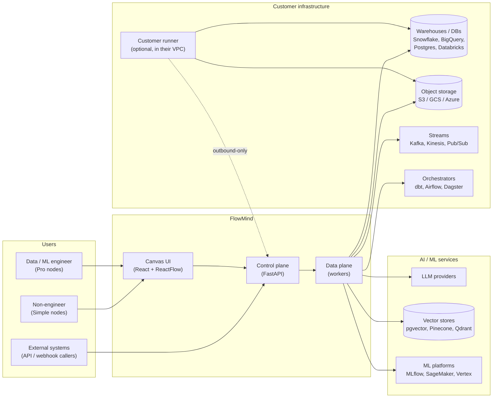

---

## 4. Control plane vs data plane

The existing FastAPI app becomes the **control plane**. A new pool of workers is the **data plane**.

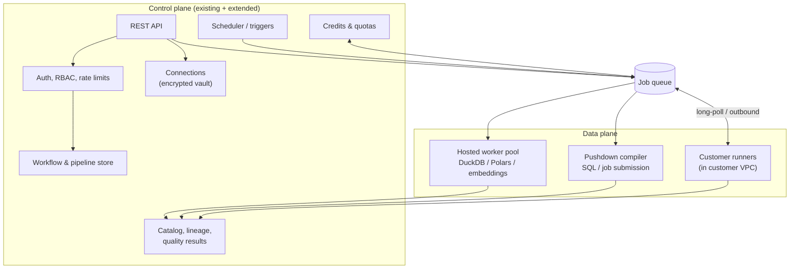

**What changes in the existing executor:** today `execute_workflow` runs nodes in-process inside the HTTP request. It becomes a *planner* that turns a graph into jobs; light nodes (rule, switch, formatter, LLM) can still run inline, while data nodes are enqueued and their results referenced by `DatasetRef`.

---

## 5. Three execution targets

Every data node has a **Run on** setting.

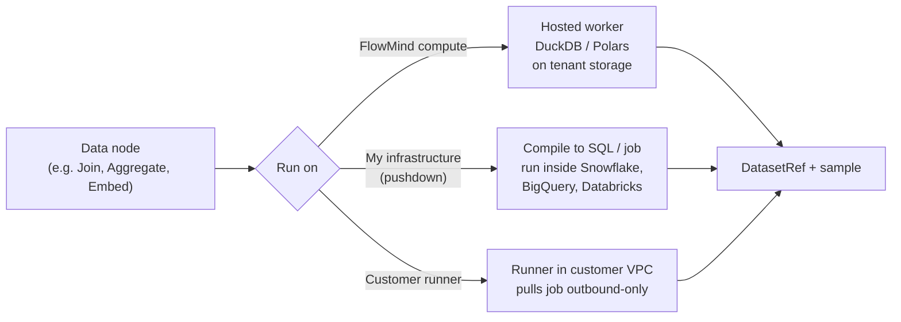

| Target | Best for | Data location | Network requirement |
|---|---|---|---|
| **FlowMind compute** | Non-engineers, small–medium data, quick starts | Tenant-scoped managed storage | None |
| **Pushdown to my infra** | Teams with a warehouse; big data | Stays in their warehouse | Warehouse reachable from FlowMind (allow-listed IPs / private link) |
| **Customer runner** | Private networks, regulated data | Stays inside their VPC | Runner makes **outbound** HTTPS only |

### Customer runner protocol

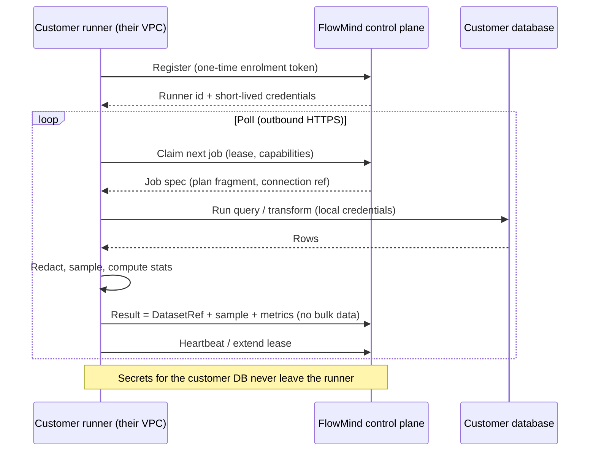

Design rule: **the control plane never needs credentials to a private database** — the runner holds them locally and only reports metadata, samples and metrics.

---

## 6. `DatasetRef` — the core abstraction

Nodes do not pass rows. They pass a reference with enough metadata to preview, validate and plan.

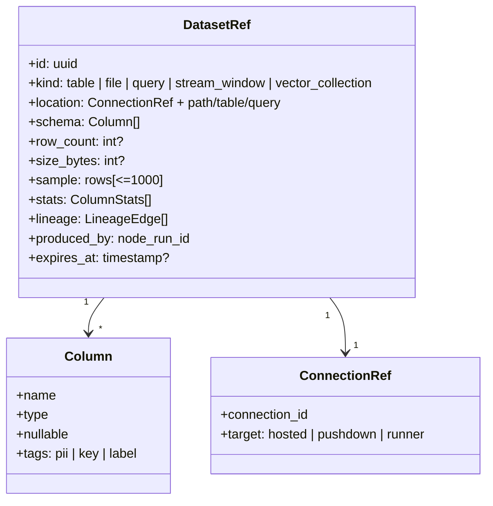

Consequences:

- **Preview everywhere:** after any node the UI shows schema, row count and a sample.
- **Dry-run:** run the whole pipeline on a ≤1,000-row sample before a full run.
- **Compatibility with existing nodes:** a `DatasetRef` can be *materialised to JSON* up to a size cap, so Rule/Switch/AI/HTTP nodes keep working.
- **PII tags:** columns tagged `pii` are redacted in persisted samples and logs (extends the redaction already in place).

---

## 7. Node catalog

### 7.1 Simple vs Pro — one engine

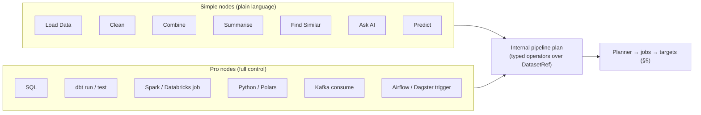

A Simple **Combine** node and a Pro **SQL** node both lower to the same join operator; an engineer can "Open as SQL" on any Simple node to see and edit what it compiles to.

### 7.2 Categories

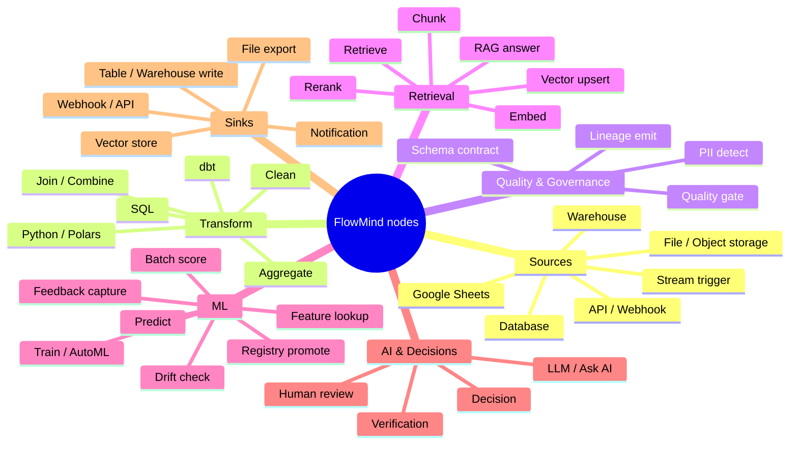

Existing nodes (Input, AI, Verification, Decision, Rule, Switch, Validator, Formatter, Aggregator, HTTP, Indian KYC, Human Review, Output) remain and interoperate.

---

## 8. Integration catalog

| Category | Integrations | Phase |
|---|---|---|
| **Databases & warehouses** | Postgres, MySQL, Snowflake, BigQuery, Redshift, Databricks SQL, ClickHouse | 2 (Postgres), 6 (rest) |
| **Files & object storage** | S3, GCS, Azure Blob (Parquet / CSV / JSON), Google Sheets | 2 |
| **Embedded engine** | DuckDB, Polars | 2 |
| **Transform & orchestration** | dbt, Airflow, Dagster, Prefect, Spark / Databricks jobs | 6 |
| **Quality & governance** | Great Expectations / Soda, schema contracts, OpenLineage, DataHub / OpenMetadata | 3 |
| **Vector & retrieval** | pgvector (managed), Pinecone, Qdrant, Weaviate, Elasticsearch / OpenSearch | 4 |
| **Streams & events** | Kafka / Redpanda, Kinesis, Pub/Sub, webhooks | 8 |
| **Feature stores** | Feast, Tecton, Databricks FS, Redis (online) | 8 |
| **ML platforms** | MLflow (first), SageMaker, Vertex AI, Azure ML, Hugging Face, Weights & Biases | 5 |
| **Serving & evaluation** | vLLM / Triton / BentoML endpoints, Ragas / DeepEval, LangSmith / Langfuse | 5 |

Every connector implements one small interface so adding more is mostly repetitive work:

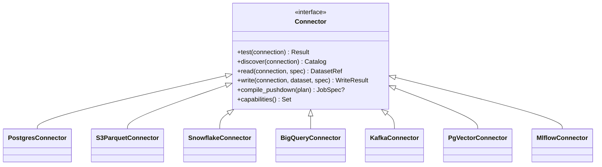

---

## 9. Execution model: batch and real-time

### 9.1 Job lifecycle

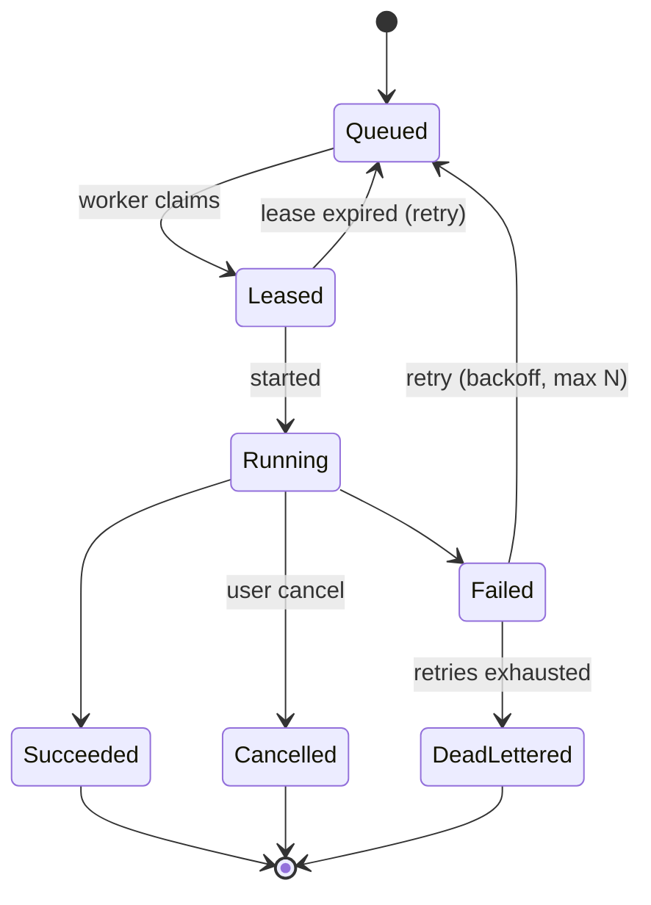

### 9.2 Batch pipeline

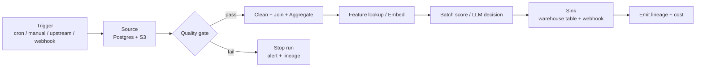

Needs: cron triggers, retries with backoff, run history, backfills (re-run for a date range), idempotent sinks (upsert / partition overwrite).

### 9.3 Real-time serving

The existing `/trigger` endpoint becomes a **low-latency serving path** for pipelines marked *online*: only operators with bounded latency are allowed (point lookups, online features, model/LLM calls); full scans and heavy joins are rejected at design time.

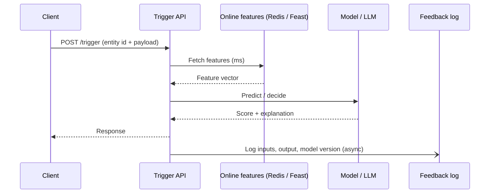

### 9.4 Streams as micro-batch

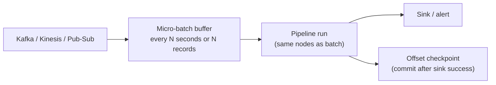

At-least-once with idempotent sinks. True event-time windows and cross-stream joins are explicitly out of scope until a streaming engine is adopted.

---

## 10. Retrieval (RAG) for production AI

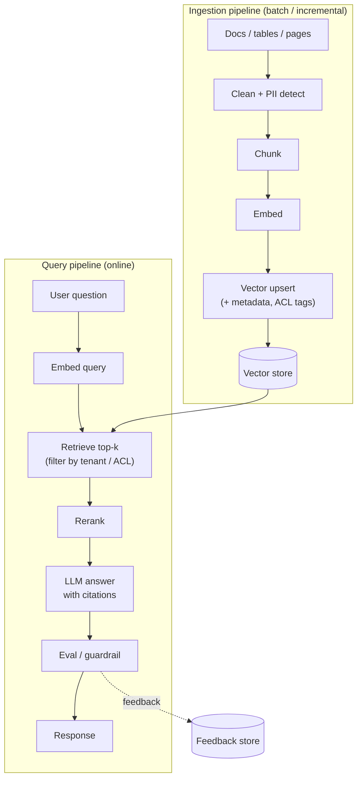

Key requirements: incremental re-indexing (only changed docs), per-tenant and per-ACL filtering at retrieval time, citation tracking, and offline evaluation (Ragas/DeepEval) as a pipeline step.

---

## 11. ML lifecycle

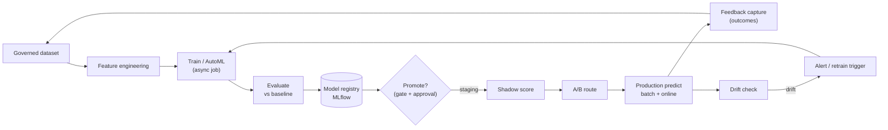

ML nodes: **Feature lookup, Predict, Batch Score, Train/AutoML, Drift Check, Registry Promote, A/B Route, Shadow Score, Feedback Capture.** Training is async-only and defaults to the customer's ML platform; hosted training is a later, quota-limited option.

---

## 12. Security, tenancy and compliance

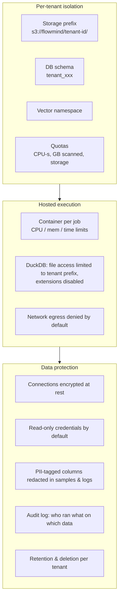

Principles carried over from the [security audit](SECURITY_AUDIT.md):

- Connection secrets use the existing encrypted vault; they are never returned by the API (only a placeholder).
- **SSRF guard:** the public-address-only rule stays the default. Private database hosts are allowed only through an **explicit per-connection allow-list** approved by an admin, or via the customer runner.
- **Hosted compute never runs arbitrary Python in the API process.** SQL and built-in operators first; user Python only once container isolation (gVisor/Firecracker or equivalent) is in place.
- Writes require an explicit permission on the connection; the default is read-only.

---

## 13. Billing and quotas

The existing **reserve → run → settle** credit logic extends naturally:

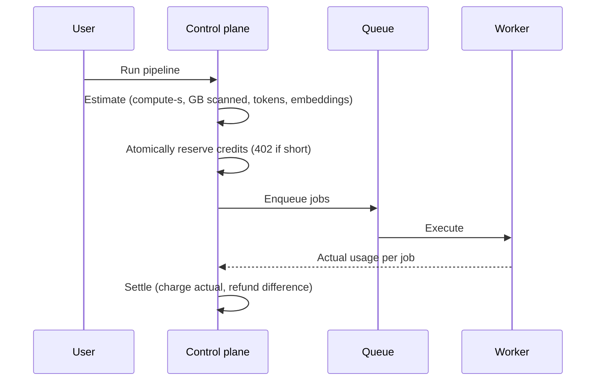

| Meter | Unit | Applies to |
|---|---|---|
| Compute | CPU-seconds | Hosted workers |
| Scan | GB scanned | Hosted engine; pushdown shows the warehouse's own bill separately |
| Storage | GB-month | Tenant managed storage / vectors |
| AI | Tokens / embeddings | LLM and embedding nodes (existing token billing) |
| Free | — | Orchestration of customer-side runner / pushdown jobs (flat or per-run fee) |

Quotas (max concurrent jobs, max GB per run, max runtime) are enforced per tenant and per plan.

---

## 14. Data model additions

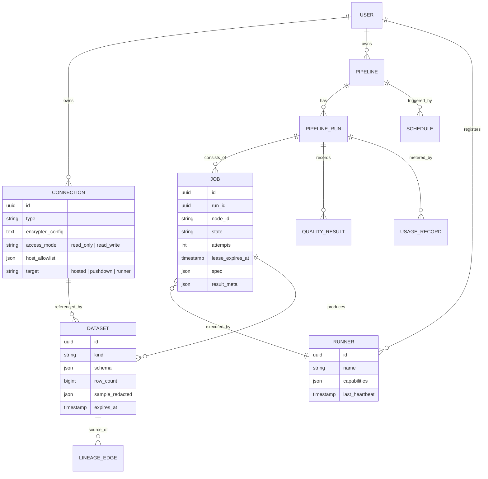

Pipelines can reuse the existing `Workflow` table (a workflow whose graph contains data nodes) rather than introducing a separate concept, so one canvas, one run history and one billing path.

---

## 15. Phased roadmap

Each phase ends with something demonstrable.

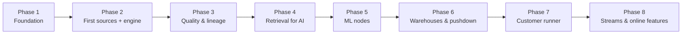

| Phase | Scope | Demo at the end |
|---|---|---|
| **1. Foundation** | Saved **Connections** (encrypted, read-only default, host allow-list); `DatasetRef`; job queue + workers; async run status API + UI; cron/scheduled triggers; retries/dead-letter | A scheduled workflow that runs asynchronously with visible job states |
| **2. First sources + engine** | Postgres, S3/GCS (Parquet/CSV), Google Sheets; **DuckDB** engine; Simple nodes (Load, Clean, Combine, Summarise); schema/sample preview; dry-run; hosted quotas + compute billing | Analyst loads a sheet + DB table, cleans, joins, previews, runs on managed compute |
| **3. Quality & lineage** | Schema contracts; quality-gate node (can stop a run); PII detect; OpenLineage emission | A pipeline that refuses to proceed on bad data and shows lineage |
| **4. Retrieval for AI** ✅ *shipped — see [phase4-retrieval.md](phase4-retrieval.md); explicit setup, pgvector/Qdrant/Weaviate/Chroma; Rerank, hybrid search and eval deferred* | Managed **pgvector**; Chunk, Embed, Vector upsert, Retrieve, Rerank, RAG Answer; incremental re-index; ACL/tenant filters; Ragas-style eval node | End-to-end RAG pipeline with citations over the user's own data |
| **5. ML nodes** | MLflow connector; Predict, Batch Score, Drift Check, Feedback Capture, Registry Promote; endpoint (SageMaker/Vertex/HF) Predict | Score a dataset with a registered model and monitor drift |
| **6. Warehouses & pushdown** | Snowflake, BigQuery, Databricks, Redshift, ClickHouse; SQL/dbt/Spark/Airflow Pro nodes; pushdown compiler | Same pipeline run inside the customer's warehouse |
| **7. Customer runner** | Runner container + enrolment/lease protocol; private-network sources | Pipeline reading a database that has no public access |
| **8. Streams & online features** | Kafka/Kinesis/Pub-Sub micro-batch triggers; Redis/Feast online features; *online* pipeline mode; A/B + shadow scoring | Sub-second scoring endpoint fed by a stream |

The job protocol designed in Phase 1 must already include **leases, capabilities and heartbeats** so the Phase 7 runner is an addition, not a rewrite.

---

## 16. Technology decisions

| Decision | Recommendation | Why |
|---|---|---|
| **Job queue** | **PostgreSQL-backed** (`SELECT … FOR UPDATE SKIP LOCKED`) behind a small `JobQueue` interface; keep Redis for rate limits/cache/pub-sub | Job state lives in the same transaction as run records and credit reservations (no dual-write); fewer moving parts. Swap to a broker behind the interface if throughput demands it. |
| **Embedded engine** | DuckDB (SQL) + Polars (dataframes) | In-process, fast on Parquet/CSV, no cluster to operate |
| **Intermediate storage** | Parquet on object storage, tenant-prefixed | Open format, cheap, shared by all engines |
| **Vector store (managed)** | pgvector first | Reuses Postgres operationally; external stores via connectors |
| **Lineage** | OpenLineage events | Industry standard; interoperates with DataHub/OpenMetadata |
| **Model registry** | MLflow first | De-facto standard; most other platforms can sync from it |
| **Worker isolation** | Containers per job (gVisor / Firecracker later) | Required before any user Python |

---

## 17. Risks and mitigations

| Risk | Mitigation |
|---|---|
| **Scope** — "everything, both ways, batch + real-time" is multi-quarter | Strict phase gates (§15); each phase independently valuable |
| **Hosted compute cost** | Quotas, credits and per-job limits ship in Phase 2, not later |
| **Multi-tenant data leakage** | Tenant-prefixed storage/schemas/namespaces, container-per-job, retrieval-time tenant filters, isolation tests in CI |
| **Regulated data (e.g. KYC) in pipelines** | PII tagging, redaction, audit log, retention/deletion, customer-runner option keeps data in their VPC |
| **Connector sprawl / test burden** | Single `Connector` interface; integration tests against real services in CI (Postgres, MinIO, Kafka containers) |
| **Non-engineer UX complexity** | Simple nodes, templates, preview and dry-run are first-class deliverables, not polish |
| **Streaming expectations** | Be explicit: micro-batch now; evaluate a streaming engine only with demand |

---

## 18. Open questions

1. **Queue backend:** confirm PostgreSQL-backed queue (recommended) vs Redis-based.
2. **Managed storage provider:** which object store and region(s) for hosted tenant data?
3. **Pricing model:** per-credit only, or plans with included compute/storage?
4. **First warehouse after Postgres:** Snowflake or BigQuery (or both) — driven by target customers.
5. **Python on hosted compute:** timeline for container isolation, and whether to offer it at all in v1.
6. **Residency/compliance:** any requirements (India data residency for KYC workloads, SOC 2) that constrain hosting choices?

---

## 19. Glossary

- **Connection** — saved, encrypted credentials + access mode + network target for an external system.
- **DatasetRef** — a pointer to data plus schema, stats, sample and lineage; the unit nodes exchange.
- **Pushdown** — compiling an operation to run inside the customer's engine instead of moving data.
- **Customer runner** — an agent in the customer's network that pulls jobs outbound-only.
- **Micro-batch** — processing a stream as small, frequent batches.
- **Quality gate** — a node that evaluates data checks and can stop the run.
