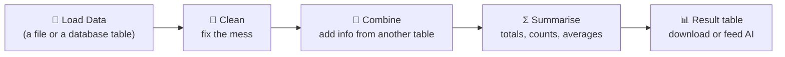
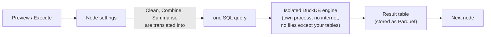

# Data Pipelines — a beginner-friendly guide

This guide teaches the data features of FlowMind **in the simplest form**. You do not need to know SQL, Python or
"data engineering". If you can use a spreadsheet, you can follow along. Engineers: skip to
[Pro mode: the SQL node](#6-pro-mode-the-sql-node) or read the
[technical reference](phase2-data-engine.md).

> **Everything here uses example files that ship with FlowMind.** One click loads them, so you can follow every
> step and compare your result with the tables below. They are all real outputs, not mock-ups.

---

## 1. The big idea in one minute

A **data pipeline** is a recipe for turning raw data into something useful:



Each box is a **node**. You drag nodes onto the canvas, connect them with lines, and set a few options. The data
flows left to right, and every node hands a **table** (rows and columns, like a spreadsheet tab) to the next.

Three words you will see everywhere:

| Word | Plain meaning | Example |
|---|---|---|
| **Table / dataset** | Rows and columns of data | `orders.csv` has 43 rows and 7 columns |
| **Node** | One step of the recipe | "Remove duplicate rows" |
| **Preview** | A free test run on a small sample that shows what each step produced | The **Preview data** button |

### Preview vs. Execute (important!)

| | **Preview data** | **Execute** |
|---|---|---|
| What it does | Runs the data steps on a **small sample** (up to 1,000 rows) | Runs the **whole thing** |
| Costs credits? | **No** | Yes (a few credits, see [costs](#9-limits-costs-and-privacy)) |
| Calls AI / web / KYC nodes? | **No** (they are skipped) | Yes |
| Saves results? | Only for a day | Saves tables you can download |
| Use it for | Checking your recipe while you build | The real run |

**Rule of thumb: build with Preview, finish with Execute.**

---

## 2. Quickstart — your first pipeline in 5 minutes

1. **Load the example data.** Click **Data** in the top bar, then **Load example data**. Four files appear:
   `messy_contacts.csv`, `sales.csv`, `orders.csv`, `customers.csv`.
2. **Open a ready-made pipeline.** Go back to the canvas. In the left panel, under **Sample Workflows**, find
   **Data: Sales by region** and click **Load**. You will see two nodes: *Daily sales* → *Revenue by region*.
3. **Click Preview data** (in the top bar). A window opens showing every step, the table it produced, and the SQL
   that was run. You should see:

| region | total_revenue | total_units |
|---|---|---|
| East | 214861 | 221 |
| North | 253369 | 232 |
| South | 260327 | 248 |
| West | 229966 | 195 |

4. **Click Execute → Run Workflow.** The same table is now saved.
5. **Go to Data → Pipeline outputs** and download it as **CSV** (opens in Excel/Sheets) or **Parquet**.


That's a complete pipeline: *load → summarise → result*. Everything below is just more nodes.

---

## 3. Getting data in

### Option A — upload a file (easiest)

**Data → Upload** (or drag a file onto the page). Supported: **CSV, TSV, JSON, JSON-lines, Parquet**, up to 25 MB each.
FlowMind reads the file immediately, so a broken file is rejected right away with a clear message instead of failing
later in the middle of a run.

Click **Preview** next to any file to see its columns, their types and the first rows.


> **Privacy by default.** Columns that look sensitive (names like `email`, `phone`, `aadhaar`, `pan`, `address`,
> `password`, `salary`…) are tagged **pii** and their values are shown as `[REDACTED]` in previews and stored results.
> The real values are still used inside your pipeline — only what is *displayed and saved for viewing* is masked.

### Option B — read a database table

1. **Connections → New connection → PostgreSQL**, fill in host, database, user and password, then **Test**.
2. In a **Load Data** node choose **A database table**, pick the connection and the table.

Connections are **read-only by default** and passwords are stored encrypted. Databases on private networks must be
allow-listed by an admin. Details: [Phase 1 guide](phase1-foundation.md).

---

## 4. The five nodes (with before → after)

Open any node by clicking it; its settings appear on the right. Column names are offered as clickable chips once you
have run **Preview data** at least once.

### 📄 Load Data — "start here"

Reads one file or one database table into the pipeline.

| Setting | What it means |
|---|---|
| Where is the data? | An uploaded file, or a database table |
| File / Connection + Table | Which one |
| Only these columns | (database) Load fewer columns — faster |
| Max rows | Stop after N rows. Blank = everything (up to 1,000,000) |

`messy_contacts.csv` — notice the stray spaces, the blank name, the repeated rows and the missing cities:

| name | email | city | age |
|---|---|---|---|
|   Asha Patel  | [REDACTED] | Mumbai |  |
| Ben Carter | [REDACTED] | London | 42 |
| Ben Carter | [REDACTED] | London | 42 |
| chloe dubois | [REDACTED] |  |  |
| Dev Sharma  | [REDACTED] | Delhi | 31 |
|  | [REDACTED] | Nowhere | 25 |

*…and 3 more rows*

### 🧹 Clean — "fix the mess"

Every option you tick becomes a step of one SQL query (you can read it in the preview).

| Option | What it does |
|---|---|
| Trim extra spaces | `"  Asha Patel "` → `"Asha Patel"` |
| Remove duplicate rows | Keeps one copy of identical rows |
| Drop rows where these are empty | Removes rows with a blank/missing value in the chosen columns |
| Fill empty values | Replaces blanks in a column with a value you choose |
| Change text case | `lowercase` or `UPPERCASE` for chosen columns |
| Rename columns | `city` → `town` |
| Keep only these columns | Throw away the rest |

Settings used in the quick tutorial: trim all, remove duplicates, drop rows with empty **name**, fill empty **city**
with `Unknown`, lowercase **email**. Result — 9 rows became 6:

| name | email | city | age |
|---|---|---|---|
| Ben Carter | [REDACTED] | London | 42 |
| chloe dubois | [REDACTED] | Unknown |  |
| Elena Rossi | [REDACTED] | Rome |  |
| Farah Khan | [REDACTED] | Dubai | 29 |
| Asha Patel | [REDACTED] | Mumbai |  |
| Dev Sharma | [REDACTED] | Delhi | 31 |

*(Emails show `[REDACTED]` because they are personal data. They really were trimmed and lower-cased.)*

The SQL this node wrote for you — copy it anywhere:

```sql
WITH s1 AS (SELECT * REPLACE (trim("name") AS "name", trim("email") AS "email", trim("city") AS "city", trim("age") AS "age") FROM input),
s2 AS (SELECT * REPLACE (lower("email") AS "email") FROM s1),
s3 AS (SELECT * FROM s2 WHERE NOT (("name" IS NULL OR trim("name") = ''))),
s4 AS (SELECT * REPLACE (COALESCE(NULLIF(trim("city"), ''), 'Unknown') AS "city") FROM s3)
SELECT DISTINCT * FROM s4
```

### 🔗 Combine — "add information from another table"

Joins two tables side by side by matching a column — like a spreadsheet **VLOOKUP**. Connect **two** nodes into it:
the first connection is the **left** table, the second is the **right**.

| Setting | What it means |
|---|---|
| Swap left and right | If you connected them in the wrong order |
| Keep… | **inner** = only rows that match on both sides · **left** = every left row, plus matches · **right** = every right row, plus matches · **full** = everything from both |
| Match rows where | The matching columns, e.g. `customer_id = customer_id` |

Orders (left) + customers (right), matched on `customer_id`. Each order now also knows who bought it:

| order_id | customer_id | order_date | product | quantity | unit_price | status | name | email | city | tier |
|---|---|---|---|---|---|---|---|---|---|---|
| 1000 | 3 | 2026-03-01 | Desk Lamp | 1 | 749 | delivered | Chloe Dubois | [REDACTED] | Paris | gold |
| 1001 | 2 | 2026-03-01 | Headphones | 1 | 2499 | cancelled | Ben Carter | [REDACTED] | London | silver |
| 1002 | 1 | 2026-03-02 | Notebook | 4 | 120 | delivered | Asha Patel | [REDACTED] | Mumbai | gold |
| 1003 | 2 | 2026-03-03 | Water Bottle | 4 | 299 | delivered | Ben Carter | [REDACTED] | London | silver |
| 1004 | 4 | 2026-03-04 | Keyboard | 1 | 1599 | delivered | Dev Sharma | [REDACTED] | Delhi | bronze |

*…and 38 more rows*

If both tables have a column with the same name, the right one is renamed with `_right` so nothing is lost.

### Σ Summarise — "totals, counts, averages"

Collapses many rows into a few. Pick what to **group by** (one result row per value) and what to **calculate**.

| Calculation | Meaning |
|---|---|
| count rows | How many rows |
| count different values | How many *distinct* values |
| total (sum) · average · smallest · largest · median | Needs a **number** column |

Group by `city`, count rows:

| city | people |
|---|---|
| Delhi | 1 |
| Dubai | 1 |
| London | 1 |
| Mumbai | 1 |
| Rome | 1 |
| Unknown | 1 |

```sql
SELECT "city", count(*) AS "people"
FROM input
GROUP BY "city"
ORDER BY "city"
```


### 🧾 SQL — "for engineers (and the curious)"

See [Pro mode](#6-pro-mode-the-sql-node).

---

## 5. Tutorials

Each tutorial has a ready-made **Sample Workflow** — load it, press **Preview data**, and compare with the tables.

### Tutorial 1 — Tidy up messy contacts  *(Sample: "Data: Tidy up messy contacts")*

**Goal:** a clean list and a count of people per city.
**Steps:** Load `messy_contacts.csv` → **Clean** (settings above) → **Summarise** (group by `city`, count rows).
**Result:** the *People per city* table above — 6 people, one per city (including `Unknown`).
**What you learned:** nodes chain; every step's SQL is visible; sensitive columns are masked.

### Tutorial 2 — Sales by region  *(Sample: "Data: Sales by region")*

**Goal:** revenue and units per region from the daily sales file.
**Steps:** Load `sales.csv` → **Summarise** (group by `region`; total of `revenue`; total of `units`).
**Result:**

| region | total_revenue | total_units |
|---|---|---|
| East | 214861 | 221 |
| North | 253369 | 232 |
| South | 260327 | 248 |
| West | 229966 | 195 |

### Tutorial 3 — Join two tables  *(Sample: "Data: Orders + customers (join)")*

**Goal:** how much did each customer *tier* spend (ignoring cancelled orders)?
**Steps:** Load `orders.csv` and `customers.csv` → **Combine** (match `customer_id`) → **SQL**:

```sql
SELECT tier,
       count(*) AS orders,
       round(sum(quantity * unit_price), 2) AS revenue
FROM input
WHERE status <> 'cancelled'
GROUP BY tier
ORDER BY revenue DESC
```

**Result:**

| tier | orders | revenue |
|---|---|---|
| silver | 18 | 64958 |
| gold | 17 | 35717 |
| bronze | 4 | 6333 |


### Tutorial 4 — Database → report

1. Add a PostgreSQL **Connection** and **Test** it.
2. **Load Data** → *A database table* → pick the table (optionally limit columns and rows).
3. Add **Clean** / **Summarise** as in the tutorials above.
4. **Preview data**, then **Execute**.

### Tutorial 5 — Run it every morning

1. Save the workflow.
2. Open **Runs → Schedules**, pick the workflow, choose *Every day at 09:00* and your timezone, press **Create**.
3. Each morning FlowMind runs it in the background; open **Runs** for status and **Data → Pipeline outputs** for the
   tables. See the [Phase 1 guide](phase1-foundation.md) for how schedules and retries behave.

---

## 6. Pro mode: the SQL node

If you know SQL, the **SQL** node lets you write one `SELECT` query over the tables connected to it.

**Table names you can use**

| Name | Refers to |
|---|---|
| `input` | The first connected node's table |
| `input2`, `input3`, … | The second, third… connected tables |
| a name from the node's label | e.g. a node labelled **Orders** can also be queried as `orders` |

(The node's settings panel lists the exact names for your canvas.)

**Example — best-selling delivered products** *(Sample: "Data: Top products (SQL)")*:

```sql
SELECT product,
       sum(quantity) AS units,
       sum(quantity * unit_price) AS revenue
FROM orders
WHERE status = 'delivered'
GROUP BY product
ORDER BY revenue DESC
LIMIT 5
```

| product | units | revenue |
|---|---|---|
| Headphones | 17 | 42483 |
| Keyboard | 10 | 15990 |
| Desk Lamp | 20 | 14980 |
| Backpack | 5 | 4450 |
| Water Bottle | 14 | 4186 |

**Rules (they keep your data and everyone else's safe):**

- **One `SELECT` statement.** `INSERT`, `DROP`, `COPY`, `ATTACH`, `PRAGMA`, `SET`, `INSTALL` are refused.
- **No files, no internet.** The query can only see the tables connected to it.
- The engine is **DuckDB**, so modern SQL works: window functions, `QUALIFY`, `date_trunc`, `strftime`, `string_agg`…
- A query is stopped after **60 seconds** or when it needs too much memory, and the message tells you what to try.

### A mini cookbook

**Orders per month**

```sql
SELECT strftime(CAST(order_date AS DATE), '%Y-%m') AS month,
       count(*) AS orders
FROM input
GROUP BY month
ORDER BY month
```

| month | orders |
|---|---|
| 2026-03 | 43 |

**Running total per customer** (window function)

```sql
SELECT order_id, customer_id, quantity * unit_price AS amount,
       sum(quantity * unit_price) OVER (PARTITION BY customer_id ORDER BY order_date) AS running_total
FROM input
WHERE customer_id = 1
ORDER BY order_date
```

| order_id | customer_id | amount | running_total |
|---|---|---|---|
| 1002 | 1 | 480 | 480 |
| 1005 | 1 | 890 | 1370 |
| 1018 | 1 | 4797 | 6167 |
| 1027 | 1 | 1498 | 7665 |
| 1034 | 1 | 240 | 7905 |

**Keep the newest row per customer** (de-duplicate by a key)

```sql
SELECT *
FROM input
QUALIFY row_number() OVER (PARTITION BY customer_id ORDER BY order_date DESC) = 1
```

**Share of total**

```sql
SELECT region, sum(revenue) AS revenue,
       round(100.0 * sum(revenue) / sum(sum(revenue)) OVER (), 1) AS pct
FROM input
GROUP BY region
```

---

## 7. How it works (the 60-second version)



- **Simple nodes are SQL in disguise.** The *Clean*, *Combine* and *Summarise* nodes don't have their own engine;
  they write a SQL query for you. That is why the preview can show the SQL, and why you can "graduate" to the SQL
  node whenever you want more control.
- **Tables are passed by reference.** Between nodes, FlowMind passes a pointer to a file, not millions of rows. Only a
  small masked **sample** is shown in the browser.
- **Safe by design.** The engine runs in a separate process that is killed when it runs too long, can't touch the
  network or any file you didn't connect, and only ever sees *your* data.

---

## 8. Using results with the rest of FlowMind

A data node's output also works with the existing nodes: connect it to a **Rule**, **Switch**, **Formatter**, **AI
Agent** or **HTTP** node. They receive the table's schema and a small sample (`dataset.sample`) — handy for
"summarise these results with AI" or "post the totals to Slack". Large tables stay in storage; download them from
**Data → Pipeline outputs**.

---

## 9. Limits, costs and privacy

| Topic | Rule |
|---|---|
| **File size** | 25 MB per upload |
| **Storage** | 500 MB per account (uploads + saved outputs). The Data page shows your usage |
| **Rows** | Load Data reads up to 1,000,000 rows; a SQL result may have up to 1,000,000 rows |
| **Time** | A query is stopped after 60 seconds |
| **Preview** | Free; samples up to 1,000 rows; AI/HTTP/KYC/code nodes are skipped |
| **Credits (Execute)** | Load 1 · Clean 1 · Summarise 1 · Combine 2 · SQL 2. Plus **1 extra credit** for every full 100 MB scanned and for every full 30 s of compute — small data costs the base price |
| **Saved outputs** | Deleted automatically after 7 days (download what you want to keep). Uploaded files stay until you delete them |
| **Sensitive data** | Columns that look personal are masked in previews, results and stored traces |
| **Who can see what** | Your files and outputs are visible only to you. Admins can see that a connection exists (never its password) |

If you run out of credits, Execute stops **before** anything runs and tells you how many credits it needs. Preview
always works.

---

## 10. When something goes wrong

| You see | It usually means | Fix |
|---|---|---|
| *File 'x.csv' not found. Upload it on the Data page first.* | The file name in Load Data doesn't exist for your account | Upload it (or **Load example data**) and pick it in the node |
| *Column 'abc' was not found in the input. Available columns: …* | Typo, or an earlier node renamed/dropped it | Use the column chips; run **Preview data** to refresh them |
| *Cannot sum 'region': it is VARCHAR, not numbers.* | You asked for a total of a text column | Pick a number column, or convert it first with SQL: `CAST(col AS DOUBLE)` |
| *Cannot match 'a' (BIGINT) with 'b' (VARCHAR): the types differ.* | The two matching columns are different types (a number vs. text) | Convert one side first (SQL node: `CAST(...)`) |
| *Combine needs two inputs…* | Only one node is connected | Connect two data nodes; first = left, second = right |
| *… needs data: connect a Load Data node to its input* | The node has nothing feeding it | Draw a line from a data node into it |
| *Only SELECT queries are allowed…* | SQL node contains INSERT/DROP/COPY/… | Use a single `SELECT` |
| *Permission Error … file system operations are disabled* | The SQL tried to read a file | Load the file with **Load Data** and query `input` |
| *The query took longer than 60s…* | Too much data / expensive query | Filter or aggregate earlier, use *Max rows*, or sample first |
| *Storage limit reached* | 500 MB full | Delete files / old outputs on the Data page |
| *Insufficient credits* | Not enough credits for Execute | Ask your admin for a top-up. Preview is still free |
| *Host … is a private or reserved address. Ask an admin to allow-list it* | Your database is on a private network | An admin adds the host to the connection's allow-list |

---

## 11. Glossary

- **CSV** — a plain-text spreadsheet; one row per line, columns separated by commas.
- **Parquet** — a compact, fast file format for tables, popular in data engineering.
- **Dataset / table** — rows and columns of data.
- **Schema** — the list of columns and their types (text, number, date…).
- **Join** — matching rows of two tables on a shared column.
- **Group by / aggregate** — collapse rows into groups and calculate a value for each (sum, count, average).
- **PII** — personally identifiable information (email, phone, ID numbers…); masked in previews.
- **SQL** — the standard language for querying tables. **DuckDB** is the engine FlowMind uses to run it.
- **Pipeline** — a workflow whose nodes move and shape data.
- **Dry run / preview** — a free test on a sample.

---

### Where next?

- Technical details, security model, API and configuration: [phase2-data-engine.md](phase2-data-engine.md)
- Connections, background runs and schedules: [phase1-foundation.md](phase1-foundation.md)
- The full roadmap (quality gates, vectors/RAG, ML, warehouses): [data-engineering-platform.md](data-engineering-platform.md)
