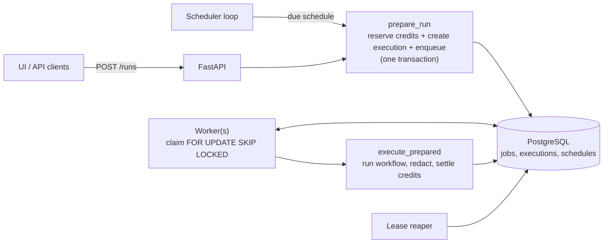
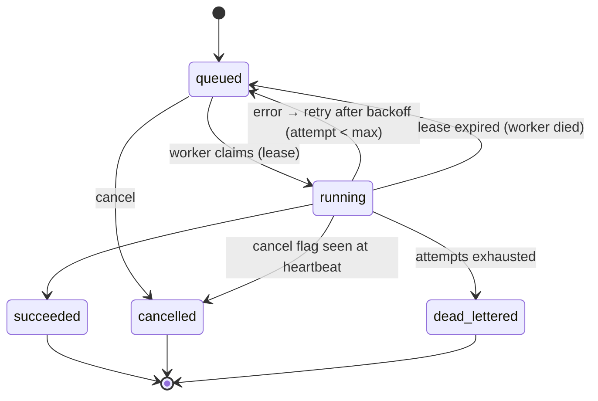

# Phase 1 — Foundation (implemented)

Implements Phase 1 of the [data engineering & ML platform design](data-engineering-platform.md): saved
**Connections**, the **`DatasetRef`** type, a **PostgreSQL-backed job queue + workers**, **async runs**
and **cron schedules**. No new data *nodes* yet — those start in Phase 2 on top of this plumbing.

## What you get

| Capability | Where |
|---|---|
| Encrypted, read-only-by-default **Connections** (PostgreSQL, HTTP API) with test / browse / preview | `app/api/connections.py`, `app/connectors/`, UI **Connections** |
| **`DatasetRef`** (schema, stats, redacted sample, lineage) | `app/data/dataset.py` |
| **Job queue** (leases, heartbeats, retries with backoff, dead-letter, cancel) | `app/jobs/queue.py`, `app/jobs/worker.py` |
| **Async runs** — start, poll, cancel, history | `POST /runs`, `GET /runs`, UI **Runs** |
| **Cron schedules** with timezone, overlap protection, credit checks | `app/jobs/scheduler.py`, `/schedules`, UI **Runs → Schedules** |
| Ops visibility | `GET /admin/jobs/stats`, Admin → Overview → *Background Jobs* |

## Architecture



### Job lifecycle (as implemented)



The design doc's *Leased* and *Running* states are one state (`running`) here, and *Failed → Queued* is the retry
transition. Retries use `JOB_RETRY_BASE_SECONDS × 2^(attempt-1)`.

## Semantics you should know

- **At-least-once delivery.** If a worker dies after side effects, the job runs again. Run settlement is
  idempotent (credits are never charged/refunded twice) and a finished execution is never re-run, but HTTP/KYC
  side effects of a *half-finished* run can repeat — keep workflows idempotent.
- **A failing node is not retried.** A workflow whose node errors completes as a *failed run* (and is billed for
  the nodes that executed). Only infrastructure failures (worker crash, DB errors) retry, then dead-letter.
- **Credits.** Reserved when the run is created (402 if short, nothing is created), settled to actual usage when
  it finishes, fully refunded when cancelled or dead-lettered. Cancelling a *running* job refunds in full (work
  already done is not billed because its results are discarded).
- **Inputs are not stored in clear.** Run input lives in the job payload, encrypted at rest and scrubbed when the
  job reaches a terminal state; `executions.input_data` stores the redacted copy.
- **Schedules** bill and use the API keys of the schedule owner, skip when the account is inactive, credits are
  short, or the previous run is still active, and collapse missed fires into one run.
- **Per-run billing identity.** The caller (not the workflow owner) is billed — relevant when an admin runs
  another user's workflow.

## Connections & network safety

- Config is stored encrypted; the API only ever returns `__secret__` placeholders for secret fields.
- Default access mode is **read-only**: Postgres sessions are opened with `default_transaction_read_only=on`.
- Private/loopback/link-local hosts are refused unless an **admin** lists the host in the connection's allow-list.
  The connector connects to the validated address (`hostaddr`), so DNS cannot change between check and connect.
- Preview/discover use parameterised queries and `psycopg2.sql.Identifier` quoting; samples are capped (≤ 200 rows,
  cells truncated) and columns whose names look sensitive (email, phone, aadhaar, pan, …) are tagged `pii` and masked.

## Running workers

Default: the API process runs an embedded worker and scheduler (`WORKER_ENABLED`, `SCHEDULER_ENABLED`).
To scale independently:

```bash
# API instances:   WORKER_ENABLED=false SCHEDULER_ENABLED=false
python -m app.worker      # one or more worker processes (also runs the scheduler)
```

Several workers and schedulers can run at once: jobs are claimed with `SKIP LOCKED`, and due schedules are
claimed and advanced in one short transaction before firing.

## API summary

| Endpoint | Purpose |
|---|---|
| `POST /runs` → 202 `{execution_id, job_id}` | start a background run |
| `GET /runs`, `GET /runs/{id}` | history; detail includes job state/attempts and redacted output/trace |
| `POST /runs/{id}/cancel` | cancel queued (immediate) or running (cooperative) |
| `GET/POST /schedules`, `PATCH/DELETE /schedules/{id}` | cron schedules (5-field cron + IANA timezone) |
| `GET /connections/types`, `GET/POST /connections`, `GET/PATCH/DELETE /connections/{id}` | connections |
| `POST /connections/{id}/test`, `GET …/discover`, `GET …/preview?schema=&table=` | test, browse tables, `DatasetRef` preview |
| `GET /admin/jobs/stats`, `GET /admin/jobs?state=` | queue health, dead-lettered jobs |

The synchronous `/workflows/{id}/execute` and `/trigger` endpoints are unchanged and now share the same run
service (reservation, redaction, idempotent settlement).

## Upgrading an existing database

Startup runs idempotent migrations (`ALTER TABLE … ADD COLUMN IF NOT EXISTS`) for the new execution columns and
creates the `jobs`, `schedules` and `connections` tables. This path is covered by a test that upgrades a
pre-Phase-1 PostgreSQL schema in place.

## Testing

```bash
cd backend && pytest                                                  # SQLite (PostgreSQL-only tests skipped)
TEST_DATABASE_URL=postgresql://user@host:5432/testdb pytest           # full suite incl. locking + live connector
```

## Not in Phase 1 (by design)

Data-processing nodes, DuckDB engine and managed storage (Phase 2); quality gates and lineage emission (Phase 3);
vector/RAG and ML nodes (Phases 4–5); warehouse connectors and pushdown (Phase 6); the customer runner (Phase 7).
The job table already carries `target`, `capabilities` and lease/heartbeat fields so the runner is an addition.
