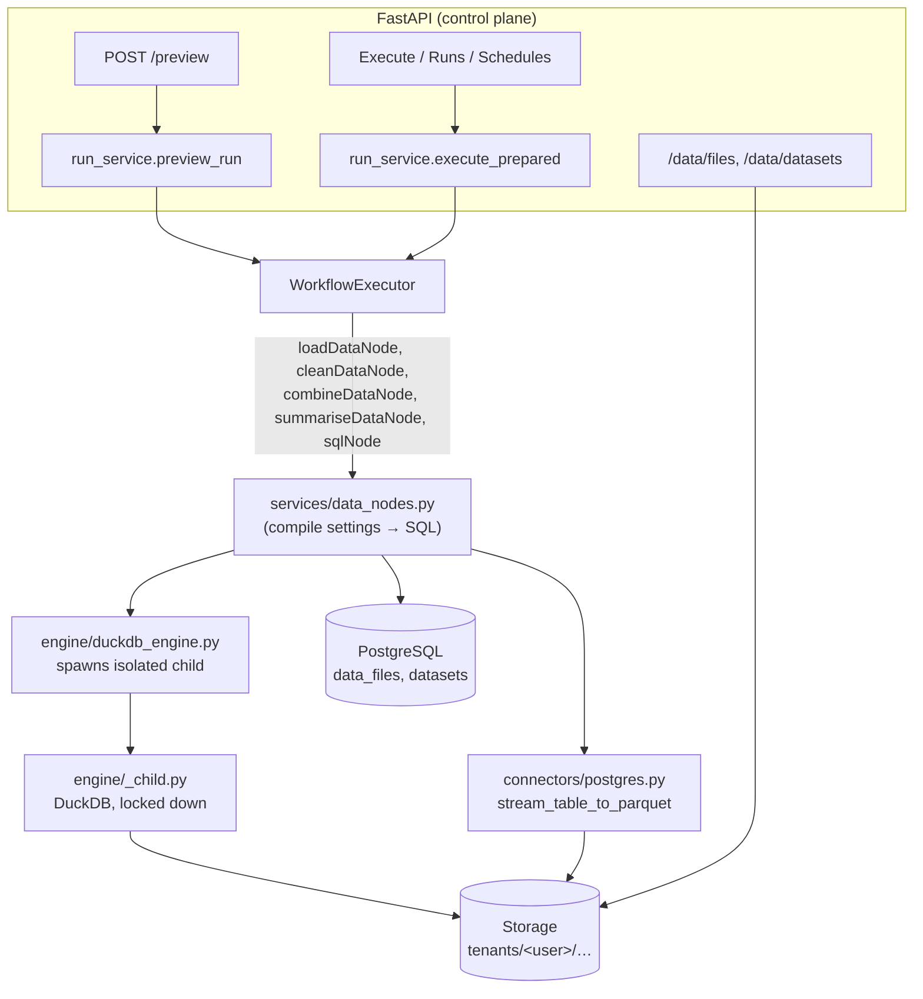
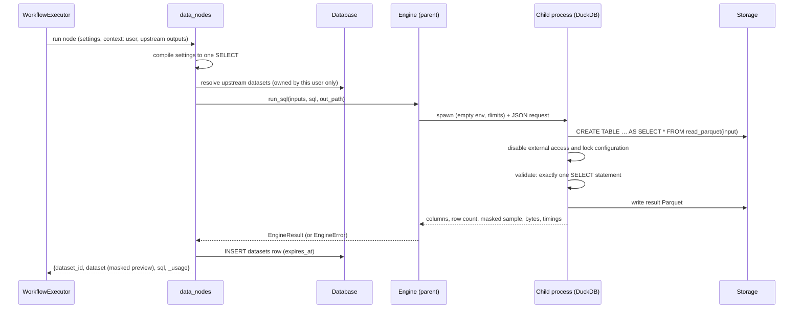
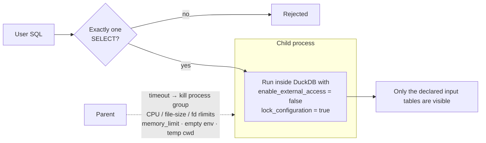
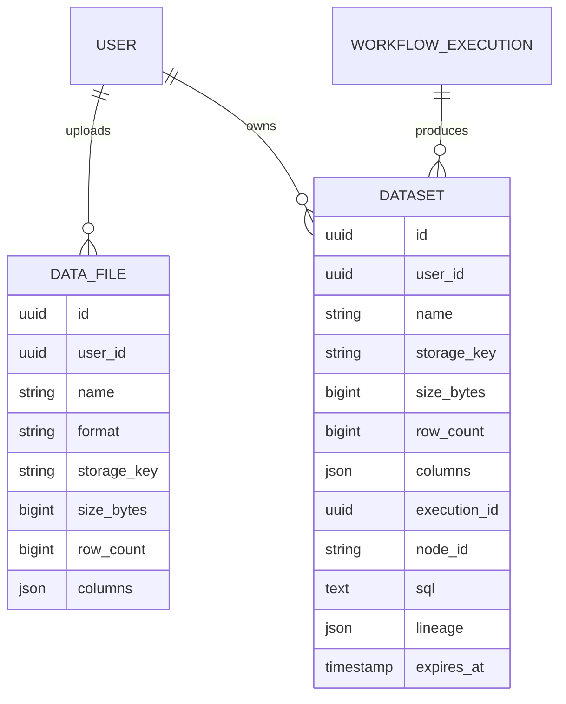

# Phase 2 — Data engine & data nodes (technical reference)

Implements Phase 2 of the [data engineering & ML platform design](data-engineering-platform.md), with the choices
made for this iteration: **local-disk storage behind a swappable interface**, **uploaded files + PostgreSQL** as sources,
**SQL-only hosted compute** (no user Python), and **no OAuth / Google Sheets yet**.

New to this? Read the [beginner guide](data-pipelines-guide.md) first.

## What was added

| Area | Delivered |
|---|---|
| Nodes | **Load Data**, **Clean**, **Combine**, **Summarise** (Simple) and **SQL** (Pro) |
| Engine | DuckDB in an isolated, killable subprocess; SELECT-only; no file/network access |
| Storage | `Storage` interface + `LocalStorage` (tenant-prefixed keys, traversal-safe) |
| Data model | `data_files` (uploads) and `datasets` (node outputs, Parquet) |
| Preview | `POST /workflows/{id}/preview` — free sample run, schema + rows + SQL per step |
| Files API | upload / list / preview / delete; example data installer |
| Datasets API | list / preview / download (CSV, Parquet) / delete; retention purge |
| Billing | per-node credits + scan/compute surcharge; storage quota |
| UI | Data page, Preview modal, five node editors with column pickers, sample workflows |

## Architecture



### How one data node runs



Nodes exchange a **`dataset_id`** (a Parquet file) plus a small masked `dataset` preview — never full tables. The
existing JSON nodes keep working because the preview is part of `previous_output`.

## Simple nodes compile to SQL

`compile_clean`, `compile_combine` and `compile_summarise` (`app/services/data_nodes.py`) are pure functions from node
settings and the upstream schema to a single `SELECT`. They validate every column against the upstream schema (so a
column name can never be interpolated unless it exists) and quote identifiers. The compiled SQL is returned in the
result (`sql`) and shown in the Preview modal.

| Node | Compiles to |
|---|---|
| Clean | CTE chain: `trim` → case → `WHERE NOT (…missing…)` → `COALESCE` fill → `SELECT DISTINCT` → rename/keep |
| Combine | `SELECT l.…, r.… FROM input AS l <INNER\|LEFT\|RIGHT\|FULL> JOIN input2 AS r ON …` with `_right` suffixes and `COALESCE` for shared keys |
| Summarise | `SELECT group cols, agg(col) AS … FROM input GROUP BY … ORDER BY …` |
| SQL | the user's query, run as-is (tables: `input`, `input2`…, plus label slugs) |
| Load Data | file → `SELECT * FROM src LIMIT n`; database → server-side cursor streamed to Parquet |

## Engine isolation



| Layer | Control |
|---|---|
| Statement type | Only `SELECT`/`WITH … SELECT`. INSERT, DROP, COPY, ATTACH, INSTALL, LOAD, PRAGMA, SET are rejected; multi-statement input is rejected |
| Input visibility | The parent resolves tenant-owned files; the child loads them into in-memory tables **before** locking |
| Lockdown | `enable_external_access=false` (no files, no HTTP), extension auto-install/load off, configuration locked |
| Resources | `memory_limit` (default 512 MB), CPU/file-size/open-file rlimits, hard timeout (default 60 s) with process-group kill, result row cap |
| Process | Separate interpreter (`-I`), empty environment, throw-away working directory |
| Concurrency | `ENGINE_MAX_CONCURRENT` slots per process |
| Errors | First line only; server paths replaced by table names |

Verified by tests (`tests/test_engine.py`): `read_csv('/etc/passwd')`, `glob('/*')`, `COPY … TO`, `ATTACH`, `INSTALL`,
`PRAGMA`, `SET enable_external_access=true`, multi-statement, empty SQL, reading a sibling file, a runaway cross-join
(killed in seconds) and a memory bomb are all refused or contained.

> This is defence in depth, not a VM boundary. Hosted *Python* stays disabled until container isolation exists
> (see the design doc §12). SQL-only keeps the attack surface small.

## Storage

```
$DATA_DIR/
└── tenants/<user_id>/
    ├── uploads/<file_id>.<csv|tsv|json|jsonl|parquet>
    └── datasets/<dataset_id>.parquet
```

- Keys are built with `tenant_key()`; every component must match `[A-Za-z0-9._-]+`, and `LocalStorage.path_for`
  refuses anything that resolves outside the root. Uploaded file *names* are sanitised and never used in paths.
- Uploads are streamed with a size cap, written to a `.part` file and renamed, and then **parsed** (a probe query) so a
  corrupt file is rejected at upload.
- The interface (`app/storage/local.py::Storage`) is the seam for S3/GCS: same keys, same operations. The engine
  currently needs local paths, so a cloud backend will either sync to a local cache or use DuckDB's `httpfs` in the
  (separately sandboxed) loader.

## Data model



New tables are created at startup; no column changes to existing tables.

## Preview (dry run)

`POST /api/v1/workflows/workflows/{id}/preview` runs the graph with `dry_run=True`:

- Load Data is capped at `DRY_RUN_ROWS` (1,000) rows; resulting datasets expire after 1 day and don't count toward the quota.
- Nodes that are paid or have side effects (AI, verification, decision, HTTP, KYC, code, human review) are **skipped**
  (`{"skipped": true}`), everything else runs. No credits are reserved or charged.
- The response lists each executed node with `status` (`ok`/`error`/`skipped`), the masked `dataset` (columns with
  types and `pii` tags, sample rows) and the `sql`. Rate limit: `PREVIEW_RATE_LIMIT_PER_MIN`.

## API

| Endpoint | Purpose |
|---|---|
| `GET /data/usage` | storage used / limit |
| `GET /data/files`, `POST /data/files` (multipart), `DELETE /data/files/{id}` | uploads |
| `GET /data/files/{id}/preview?limit=` | `DatasetRef` with masked sample |
| `POST /data/examples` | install bundled example CSVs (idempotent) |
| `GET /data/datasets`, `GET /data/datasets/{id}/preview`, `DELETE …` | node outputs |
| `GET /data/datasets/{id}/download?format=csv\|parquet` | export |
| `POST /workflows/workflows/{id}/preview` | sample run (above) |

Errors: `413` for size/quota, `422` for unreadable files, `404` for anything not owned by the caller.

## Configuration

| Setting | Default | Meaning |
|---|---|---|
| `DATA_DIR` | `./data` | storage root |
| `MAX_UPLOAD_MB` | 25 | per-file upload limit |
| `MAX_STORAGE_MB_PER_USER` | 500 | uploads + saved outputs |
| `ENGINE_TIMEOUT_S` | 60 | hard kill for a SQL job |
| `ENGINE_MEMORY_MB` | 512 | DuckDB memory limit per job |
| `ENGINE_MAX_CONCURRENT` | 2 | concurrent SQL jobs per process |
| `MAX_LOAD_ROWS` / `MAX_RESULT_ROWS` | 1,000,000 | row caps |
| `DRY_RUN_ROWS` | 1000 | preview sample size |
| `DATASET_RETENTION_DAYS` | 7 | automatic deletion of run outputs (0 = keep) |
| `PREVIEW_RATE_LIMIT_PER_MIN` | 20 | preview calls per user |

## Billing

Flat base per node — Load 1, Clean 1, Summarise 1, Combine 2, SQL 2 — plus **+1 credit per full 100 MB scanned and per
full 30 s of compute** (so small data costs the base price). Reserved up front with the flat estimate and settled to
actual usage after the run (same reserve → settle logic as Phase 1). A failed data node does no billable work and is
not charged. Preview is free.

## Privacy

- Columns whose names look sensitive are tagged `pii` (`app/data/dataset.py`) and their sample values are replaced with
  `[REDACTED]` in every preview, stored trace and API response. Real values are used by the engine; only *displayed*
  samples are masked.
- Run outputs expire automatically; uploads persist until deleted. All access is scoped to the owning user.
- CSV downloads are written verbatim. If you open downloads in a spreadsheet, treat cells beginning with `=`, `+`,
  `-` or `@` as untrusted (CSV formula injection).

## Testing

```bash
cd backend
pytest                                          # SQLite
TEST_DATABASE_URL=postgresql://… pytest         # + PostgreSQL (live load node, locking)
```

New suites: `test_engine.py` (isolation, limits, formats), `test_data_nodes.py` (compilers, pipelines checked against
plain-Python expectations, isolation between users, upload validation, quotas, retention, background runs, PostgreSQL
load with type mapping). A browser test drives Data page → sample → preview (SQL visible, PII masked) → execute →
CSV download.

## Known limitations

- Local disk only; one process's `ENGINE_MAX_CONCURRENT` is not a cluster-wide limit.
- Inputs are copied into the engine's memory (bounded by `ENGINE_MEMORY_MB`), so very large files need an earlier
  *Max rows* or a database-side filter; out-of-core/partitioned reads come with the cloud/warehouse phases.
- PostgreSQL `NUMERIC` is loaded as `DOUBLE` (precision beyond ~15 digits is lost); unknown types load as text.
- The Load node reads whole tables or column subsets; arbitrary SQL against the customer database is a Phase 6 pushdown feature.
- Combine uses the first two connected inputs (edge order); use the SQL node for 3-way joins.
- Excel (`.xlsx`) and Google Sheets are not supported yet (Sheets needs OAuth — planned later).

## Next (Phase 3)

Quality gates (schema contracts, null/uniqueness/range checks that can stop a run), PII detection on values, and
OpenLineage events — building on the `dataset` lineage already recorded per node.
