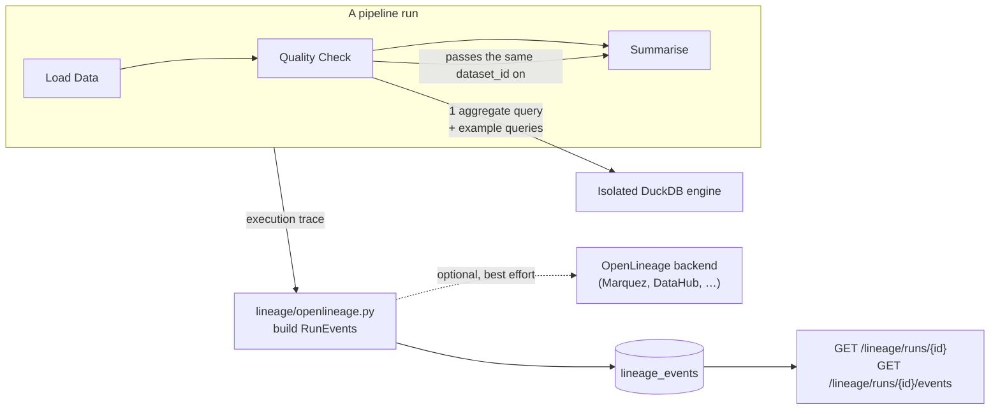
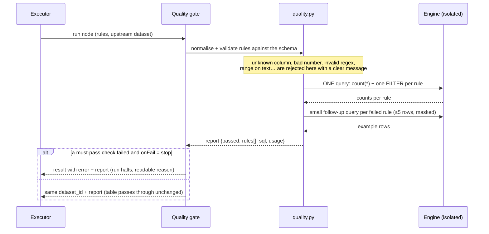
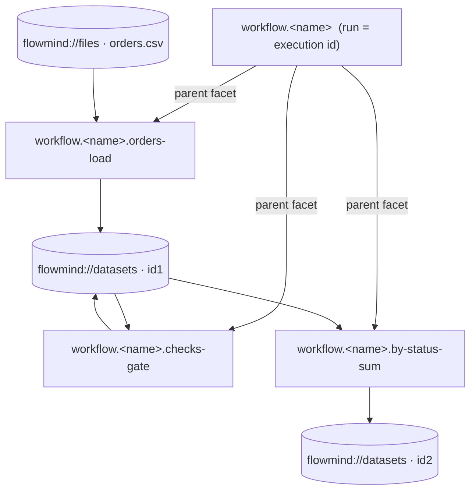

# Phase 3 — Trust in the data: quality gates, PII detection, profiling, lineage

Implements Phase 3 of the [data engineering & ML platform design](data-engineering-platform.md). It builds on the
[Phase 2 engine](phase2-data-engine.md): every check runs inside the same isolated, SELECT-only DuckDB process.

New to this? Start with the [beginner guide](data-pipelines-guide.md#-quality-check--stop-bad-data-early).

## What was added

| Area | Delivered |
|---|---|
| **Quality Check node** | 10 rule types, per-rule severity (`error` / `warn`), `stop` or `warn` mode, example offending rows, single-pass evaluation |
| **Schema contracts** | `schema` rule: required columns, optional type families, optional "no extra columns" |
| **PII detection on values** | Email, phone, Aadhaar (Verhoeff), PAN, payment cards (Luhn), IBAN (mod 97), SSN, IPv4 — in addition to name-based tagging |
| **Protect personal data** | Clean node option: `hash` (optionally salted) / `mask` / `redact` / `blank` |
| **Profiling + suggestions** | `GET /data/files/{id}/profile`, `GET /data/datasets/{id}/profile`; proposes checks with plain-language reasons |
| **Lineage** | OpenLineage `RunEvent`s per run (workflow + one child run per data node), stored and exportable; optional forwarding to Marquez/DataHub/OpenMetadata |
| **UI** | Quality Check editor with suggestions, quality report with examples in Preview, Profile on the Data page, Lineage + JSON export in Runs |

## Architecture



### How a quality gate runs



## Quality rules

Each rule is a JSON object in the node's `rules` list. All accept `severity` (`error` default | `warn`) and optional `id`.

| `type` | Settings | Violation (per row unless noted) |
|---|---|---|
| `not_null` | `columns` (or `column`) | NULL, or empty / blank text |
| `unique` | `columns` | *duplicated values* (groups with more than one row); NULLs ignored |
| `range` | `column`, `min?`, `max?` | outside `[min, max]`; numbers, or dates like `2026-03-31`; NULLs ignored |
| `allowed_values` | `column`, `values` (list or comma string, ≤ 200) | not in the list (compared as text) |
| `regex` | `column`, `pattern` | text does not match (DuckDB RE2 syntax; ≤ 500 chars) |
| `max_null_pct` | `column`, `max` (0–100) | table-level: percent empty is above `max` |
| `min_rows` / `max_rows` | `value` | table-level |
| `schema` | `expected: [{name, type?}]`, `allowExtra?` | table-level: missing column, wrong type family, unexpected columns |
| `expression` | `expression`, `label?` | row where the SQL expression is not TRUE |

Type families for `schema`: `integer`, `number` (accepts integers), `text`, `boolean`, `date`, `timestamp`, or an
exact DuckDB type name.

Node settings: `rules`, `onFail` (`stop` | `warn`). The node result keeps `dataset_id` / `dataset` of its input and
adds `quality`:

```json
{
  "passed": false, "total_rows": 16, "checks": 5, "failed_errors": 5, "failed_warnings": 0,
  "rules": [
    { "id": "r3", "type": "range", "description": "quantity must be between 1 and 100", "severity": "error",
      "status": "fail", "failed": 3, "unit": "rows", "message": "3 of 16 rows break this rule",
      "columns": ["quantity"], "examples": [{ "order_id": 2004, "quantity": -2, "…": "…" }] }
  ],
  "sql": "SELECT count(*) AS total, … FROM input"
}
```

`passed` is `false` only when a **must-pass** rule failed. Warn-only failures are counted in `failed_warnings`.

### Safety of rule values

Rule parameters are never concatenated blindly: columns must exist in the upstream schema and are quoted, string
values are escaped, numbers are parsed, dates match a strict pattern, and the regex is syntax-checked. The only free-form
input is `expression`; it must be a single expression (no `;`) and it runs inside the same engine as the SQL node
(SELECT-only, no files or network). Tests cover quote-injection in `allowed_values`, an unbalanced regex, and an
expression that tries `read_csv('/etc/passwd')` (refused by the engine).

## PII detection

`app/data/pii.py` classifies a column by its **values** when its name looks harmless:

| Kind | Rule |
|---|---|
| `email` | `local@domain.tld` |
| `phone` | 10–15 digits with `+` or separators, or a 10-digit number starting 6–9 |
| `aadhaar` | 12 digits (spaces allowed), first digit 2–9, **Verhoeff checksum** valid |
| `pan` | `AAAAA9999A` |
| `card` | 13–19 digits, **Luhn** valid |
| `iban` | country + check digits, **mod-97** valid |
| `ssn` | `123-45-6789` |
| `ipv4` | dotted quad |

A column is tagged `pii` + `pii:<kind>` when at least 2 non-empty sampled values exist and ≥ 80 % match. Detectors are
tried most-specific first. It looks at the preview **sample** (≤ 100 rows), so very sparse columns can be missed;
conversely a checksum-less pattern such as phone can occasionally flag a numeric ID. Tagged columns are masked in
previews, quality-check examples, stored traces and profile output (`min`/`max`/values are withheld).

### Protecting data in a pipeline

Clean → `protect: [{column, method}]` (`hashSalt` optional):

| Method | SQL |
|---|---|
| `hash` | `sha256(salt \|\| CAST(col AS VARCHAR))` (hex) |
| `mask` | stars + last 4 characters |
| `redact` | `'[REMOVED]'` |
| `blank` | `CAST(NULL AS <type>)` |

Unsalted hashes of low-entropy values (phone numbers) can be reversed by enumeration; use `hashSalt`.

## Profiling and suggested checks

One aggregate query returns, per column, empty count, distinct count, min, max (and mean for numbers); a second,
tiny query lists the values of low-cardinality text columns (≤ 8 distinct, ≥ 10 rows, never for PII columns). From these:

| Suggestion | When |
|---|---|
| `min_rows ≥ 1` | table not empty |
| `not_null` | no empty values and the name looks like a key, or every value is distinct |
| `unique` | key-like name (`*_id`, `*_key`, `*_code`…) with every value distinct (≥ 5 rows) |
| `range` (warn) | numeric, non-key, non-PII column — observed min/max |
| `allowed_values` | low-cardinality text column |
| `max_null_pct` (warn) | column that already has some empties — observed % + 5 |

Suggestions are drafts with a human-readable `reason`; the tests assert that the suggested checks pass on the data
they were derived from, and that they do **not** include a `unique` suggestion for a key that has duplicates.

## Lineage (OpenLineage)

Events are built with the official `openlineage-python` classes, so facet names, schema URLs and shapes follow the spec.



| Event | Content |
|---|---|
| Workflow START / COMPLETE or FAIL | external sources read (`flowmind://files`, `postgres://host:port`), terminal tables produced, `errorMessage` facet on failure |
| Node START / COMPLETE or FAIL | `parent` run facet; `inputs` (files, tables, upstream datasets); `outputs` with `schema` facet and `outputStatistics` (rows, bytes); `sql` job facet |
| Quality gate | input dataset facets `dataQualityAssertions` (one assertion per rule: `success`, `column`) and `dataQualityMetrics` (row count, null counts of `not_null` columns); FAIL when the gate stopped the run |

A real gate event (trimmed):

```json
{
  "eventType": "COMPLETE",
  "producer": "https://github.com/sohamvyas73/flowmind-ai",
  "schemaURL": "https://openlineage.io/spec/2-0-2/OpenLineage.json#/$defs/RunEvent",
  "run": { "runId": "caffb068-65bd-5d0a-ae66-c19b09d59970",
           "facets": { "parent": { "run": { "runId": "817c0174-…" },
                                   "job": { "namespace": "flowmind", "name": "workflow.order-pipeline" } } } },
  "job": { "namespace": "flowmind", "name": "workflow.order-pipeline.checks-gate",
           "facets": { "sql": { "query": "SELECT count(*) AS total, … FROM input" } } },
  "inputs": [ { "namespace": "flowmind://datasets", "name": "689276ec-9ef8-4893-8a32-5a68dc4f94f5",
                "inputFacets": {
                  "dataQualityAssertions": { "assertions": [
                    { "assertion": "unique: order_id must be unique", "success": true, "column": "order_id" },
                    { "assertion": "not_null: customer_id must not be empty", "success": true, "column": "customer_id" } ] },
                  "dataQualityMetrics": { "rowCount": 43, "columnMetrics": { "customer_id": { "nullCount": 0 } } } } } ],
  "outputs": [ { "namespace": "flowmind://datasets", "name": "689276ec-9ef8-4893-8a32-5a68dc4f94f5" } ]
}
```

**Only runs that executed data nodes emit events** (a run with just AI/HTTP nodes records none). Event times for node runs
use the trace timestamps. Events are stored in `lineage_events` (retention follows run history,
`EXECUTION_RETENTION_DAYS`) and never affect the run: a failure to record or deliver them is logged and ignored.

### Sending events to a lineage backend

```bash
OPENLINEAGE_URL=http://marquez:5000        # events are POSTed to {URL}/api/v1/lineage
OPENLINEAGE_API_KEY=...                    # optional Bearer token
OPENLINEAGE_NAMESPACE=flowmind             # job namespace
```

Delivery is best effort (5 s timeout, stops after the first rejected event). The delivery code is covered by tests
that mock the HTTP client; it has **not** been exercised against a live Marquez/DataHub in this repository's CI, so
treat the first integration as something to verify in your environment. The same events are always available through
`GET /lineage/runs/{id}/events` and the **OpenLineage JSON** button, which you can post manually.

> `OPENLINEAGE_URL` is administrator configuration, not user input, so it is called with a plain HTTP client (private
> addresses allowed). Do not point it at untrusted hosts.

## API

| Endpoint | Purpose |
|---|---|
| `GET /data/files/{id}/profile` | per-column statistics and suggested checks for an uploaded file |
| `GET /data/datasets/{id}/profile` | same for a pipeline dataset |
| `GET /lineage/runs/{execution_id}` | human-friendly steps: what each read/produced, rows, quality summary |
| `GET /lineage/runs/{execution_id}/events` | the run's OpenLineage `RunEvent`s |
| `POST /workflows/{id}/preview` | now also returns each gate's `quality` report |

All endpoints are scoped to the owner (`403`/`404` for others, `401` without a token).

## Billing

Quality Check: 1 credit flat (+ the usual +1 per 100 MB scanned / 30 s compute). A gate that **fails** is billed
(it did the work that protected your data); other failed data nodes are not.

## Configuration

| Setting | Default | Meaning |
|---|---|---|
| `OPENLINEAGE_NAMESPACE` | `flowmind` | namespace of job names |
| `OPENLINEAGE_URL` | unset | forward events to this OpenLineage backend |
| `OPENLINEAGE_API_KEY` | unset | Bearer token for that backend |

## Testing

`tests/test_quality.py` (32 tests): value-based PII detection (positives, look-alikes, checksum rejections, thresholds),
every rule type compared against plain-Python expectations on `orders_dirty.csv`, stop / warn / warn-severity behaviour,
schema contracts, configuration errors, injection attempts, masked examples, profile statistics and suggestions
(including "suggested checks pass on their source data"), Protect (hash determinism, salt, mask, redact, blank), billing,
OpenLineage event structure (parent facets, schema, statistics, SQL, assertions, FAIL events), ownership,
retention, a mocked backend sink (and sink outages), background runs, and a check against the client library's facet URLs.
Plus a browser test: profile → gate preview with examples → stop → run history lineage → JSON export → suggestions.

## Known limitations

- Checks run on the **whole table** the gate receives (bounded by the engine's memory/time limits); there is no
  sampling mode and no history/anomaly detection ("compared with yesterday") yet.
- PII value detection samples ≤ 100 rows and is heuristic. It complements, not replaces, a data-classification policy.
- Lineage is table-level. Column-level lineage (which output column came from which input column) is not generated yet.
- Quality results are stored in the run's trace and lineage events; there is no separate trend dashboard yet.
- Gates are linear checkpoints; routing "fail → a different branch" (e.g. send to human review) is not implemented —
  use *Keep going, just report it* plus a downstream Rule/Switch node on `quality.passed`.

## Next (Phase 4)

Retrieval for AI: managed vector storage, Chunk / Embed / Retrieve / Rerank / RAG-answer nodes, incremental re-indexing,
and quality/lineage events for the retrieval pipeline.
